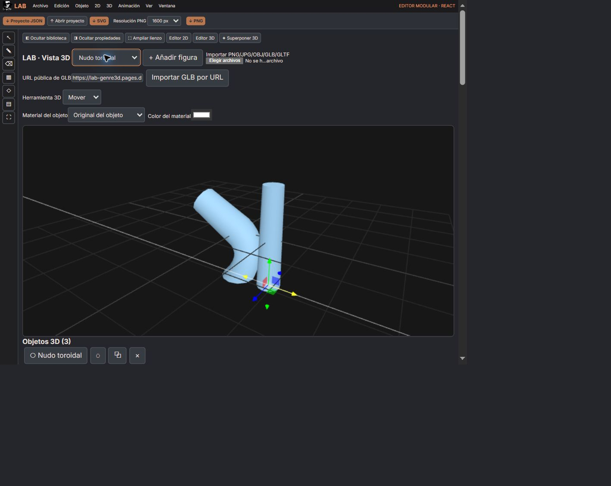

# Compatibilidad GENRE3D — consolidación 30 octubre 2026

Autorización del usuario ampliada explícitamente para compatibilidad de LAB Studio. Cambios sobre main, sin ramas nuevas.

## Implementado
- Conserva los clips del GLB al importar; selector de clip y activación de animación nativa.
- Evaluación absoluta de huesos, expresiones y transformaciones desde la línea de tiempo existente.
- Contenedor de normalización separado del nodo animado para que el ajuste de tamaño no sobrescriba el rig.
- Duplicación con SkeletonUtils para aislar los huesos del original y la copia.
- Superposición evalúa el primer clip del GLB, tanto en preview como en el render de composición.
- Importación por URL HTTPS pública, con límite de archivo de 40 MB y tratamiento de errores.

## Verificado
Compilación TypeScript/Vite correcta. Prueba con GLB emitido por GENRE3D/Three 0.175 cargado en Studio/Three 0.180: hueso del codo y morph de volumen coinciden a mitad del clip; duplicación de esqueleto aislada. 24 pruebas afectadas aprobadas (importedClips y surfaces).

En navegador publicado: importación desde https://lab-genre3d.pages.dev/fixtures/genre3d-rig-animation.glb muestra «Recurso añadido ... · 1 clip(s) animados». Selector reconoce «GENRE3D_Codo_Volumen · 1.00 s». Línea de tiempo llega a 1.00 / 1.00 s y se observa el modelo importado deformado al quitar el bucle. No afirmar todavía prueba completa de superposición y duplicación mediante UI.

## Pendiente de prueba visual
Duplicación e independencia en UI, superposición de GLB animado sobre composición 2D y exportación de esa composición. La conexión del navegador falló después de las pruebas anteriores («Debugger unattached»); no se repitieron las pruebas completadas.

El manifiesto .lab.json sigue siendo metadatos; no es un proyecto de Studio. El recurso transferible es el .glb. Las escenas 3D no se han integrado al formato general de proyecto JSON en esta entrega.

Consolidación de GENRE3D: https://github.com/ddepazos/LAB-GENRE3D/blob/main/docs/CONSOLIDACION-SUITE-2026-10-30.md

## Actualización visual posterior
La conexión Browser se recuperó. En una prueba nueva con el fixture de GENRE3D, se llevó el original al final, se duplicó y se llevó la copia al inicio. La copia queda recta en X=1 mientras el original permanece doblado; ambos figuran en jerarquía con su clip disponible. Duplicación independiente comprobada en UI. Continúa pendiente la superposición/exportación del modelo animado sobre 2D.

